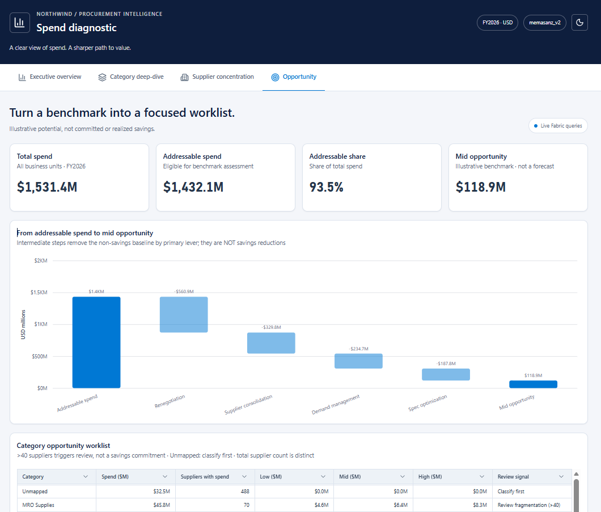

# 2. Build our App

Turn a synthetic procurement workbook into a live Fabric app for exploring spend and illustrative savings opportunities.

**What you will build:** Excel workbook -> schema-enabled lakehouse -> Direct Lake semantic model -> four-page Rayfin app.

## How to work through the lab

Clone this hackathon repo locally. Open the repo folder in your coding agent.

1. [Create a semantic model in Fabric](#1-create-a-semantic-model-in-fabric) (~20 minutes) - Confirm inputs, load the workbook, and build and validate the model.
2. [Build a visualization](#2-build-a-visualization) - Scaffold the app, connect to the model, build its pages, and deploy.
3. [Change the visualization (optional)](#3-change-the-visualization-optional) - Update a chart in the app and deploy the change.

The semantic-model exercise offers a simple goal-based prompt and a detailed prompt; choose one. The app exercise uses a single scoped prompt. Optionally, use the visualization-change prompt to refine your app. Review each result before continuing.

Use the **same chat and workspace** throughout. If you start a new chat, provide this page, your current exercise, your confirmed inputs, and the item IDs reported by the agent. Do not paste tokens or credentials.

## Inputs

Use the synthetic [Northwind Spend workbook](../../data/Northwind_Spend_Extract_FY2026.xlsx) included in this repository at `data/Northwind_Spend_Extract_FY2026.xlsx`. No separate download is needed.

Have these values ready:

| Input | What to provide |
|---|---|
| Workbook | `data/Northwind_Spend_Extract_FY2026.xlsx`, relative to the repository root |
| Alias | A short lowercase alias using letters and numbers, unique within the workspace |
| Tenant ID | The hackathon tenant supplied by the organizer |
| Workspace name | The team's workspace on an active Fabric capacity; you need Admin or Member access |

## Item names

Your alias keeps your work separate from other participants in the shared workspace:

| Item | Name |
|---|---|
| Lakehouse | `northwind_lh_<ALIAS>` |
| Notebook | `load_spend_workbook_<ALIAS>` |
| Semantic model | `Northwind Spend Model - <ALIAS>` |
| App | `spend-diagnostic-<ALIAS>` |

Use your own items and check before replacing existing work. Let the agent use the installed Fabric skills and the app's generated guidance for implementation details.

## 1. Create a semantic model in Fabric

Use the included workbook to create a schema-enabled lakehouse and a validated Direct Lake semantic model.

### Sign in

Open a terminal in the repository root and sign in:

```text
az login --tenant <TENANT_ID>
```

### Pick your model prompt

Choose **one** option, fill in any inputs you already know, and paste it into your coding agent. The agent should ask for missing inputs:

| Option | Approach |
|---|---|
| [Let the agent decide](#model-option-1-let-the-agent-decide) | Describe the goal and let the agent choose the model design from the workbook. Results may differ. |
| [Detailed instructions](#model-option-2-detailed-instructions) | Specify the tables, relationships, measures, and roles for a consistent lab result. |

Both options use the same workbook and inputs. Do not run both.

#### Model option 1: Let the agent decide

```text
Explore the Northwind spend Excel spreadsheet in this repository and load
it into a schema-enabled lakehouse in Fabric, then build and validate a
Direct Lake semantic model over the loaded data. Choose the model design
based on the workbook. I am going to build an app that lets me interact
with this data, and an agent later.
Use my alias in every Fabric item name.

Inputs:
- Workbook: data/Northwind_Spend_Extract_FY2026.xlsx
- Alias: <ALIAS>
- Tenant ID: <TENANT_ID>
- Fabric workspace name: <WORKSPACE_NAME>

Before exploring the workbook or creating Fabric items, ask me for my
alias, tenant ID, and Fabric workspace name if they are not already
provided here or in this conversation. Treat unreplaced placeholders as
missing inputs. Ask only for missing values; do not guess them.
```

#### Model option 2: Detailed instructions

```text
Create the Fabric data foundation for a Northwind procurement spend app.
Use the installed Fabric skills for ingestion and semantic-model-authoring
for the model.

Inputs:
- Workbook: data/Northwind_Spend_Extract_FY2026.xlsx
- Alias: <ALIAS>
- Tenant ID: <TENANT_ID>
- Fabric workspace name: <WORKSPACE_NAME>

Before exploring the workbook or creating Fabric items, ask me for my
alias, tenant ID, and Fabric workspace name if they are not already
provided here or in this conversation. Treat unreplaced placeholders as
missing inputs. Ask only for missing values; do not guess them.

Use my alias in every Fabric item name.
Check for existing items before creating them, and do not overwrite
another participant's work.

Read the workbook's README and load its five data sheets into the
schema-enabled lakehouse northwind_lh_<ALIAS>. Upload the workbook to
Files/raw/ and create and run load_spend_workbook_<ALIAS> to load:
- Spend_Lines -> dbo.spend_lines
- Suppliers -> dbo.suppliers
- Categories -> dbo.categories
- Business_Units -> dbo.business_units
- Calendar -> dbo.calendar
Make reruns safe for these lab tables. Keep IDs and po_number as text
and dates as date values. Identify suppliers by supplier_id, not name,
and retain Unmapped categories. Validate counts, types, and spend through
the SQL endpoint; refresh its metadata and retry if tables are not visible.

Author Northwind Spend Model - <ALIAS> as a complete TMDL model, then
deploy it using Direct Lake over all five tables with schemaName: dbo.
Add many-to-one, single-direction relationships from spend_lines:
- supplier_id -> suppliers[supplier_id]
- category_l2 -> categories[category_l2]
- business_unit -> business_units[business_unit]
- invoice_date -> calendar[date]
Mark calendar as the date table, sort month_name by month_number,
and hide spend_lines[supplier_id], po_number, and invoice_line_id.

Add these 15 measures to spend_lines, each with a description:
- Total Spend: sum of invoice_amount_usd.
- Addressable Spend: spend in addressable categories.
- Addressable %: Addressable Spend / Total Spend.
- Savings Opportunity Low: sum of category spend times its low savings rate.
- Savings Opportunity Mid: average of the low and high opportunities.
- Savings Opportunity High: sum of category spend times its high savings rate.
- Supplier Count: distinct suppliers with spend.
- Invoice Lines: count of invoice lines.
- Non-PO Spend %: spend share where po_flag = Non-PO.
- Tail Spend %: spend share with Tail-tier suppliers.
- Contract Coverage %: spend share with suppliers under contract.
- Unmapped Spend %: spend share in the Unmapped category.
- Top 10 Supplier Share %: spend share with the ten largest suppliers.
- Weighted Payment Terms (days): payment terms weighted by invoice amount.
- Spend % of Revenue: spend divided by business-unit revenue.
Format monetary measures as $#,0.0,,"M", percentages as 0.0%,
counts as #,0, and payment terms as 0.0.
Use each category's own savings rate and the workbook's percentage units.
Convert business-unit revenue from millions to dollars before dividing.

Add three RLS roles with read permission:
- Aerospace only: business_units[business_unit] = "Aerospace Components".
- BU lead (dynamic): business_units[bu_lead_email] = USERPRINCIPALNAME().
- Engagement team: no filter.

Validate all 15 measures with DAX through the executeQueries API against
independent workbook calculations, including business-unit/category slices.
Check role definitions; mark runtime RLS unverified if no Viewer test
identity is available, since Admin/Member accounts bypass RLS.

Report the workspace, lakehouse, notebook, and semantic model IDs,
validation results, and anything that could not be verified.
Stop after the semantic model is ready; do not build the app yet.
```

### Check the model

Review the agent's summary and confirm that the model is deployed and its results reconcile to the workbook. Keep the reported workspace and model IDs for the next task.

For the detailed option, expect **five tables, four relationships, 15 measures, and three roles**. For the flexible option, review the agent's chosen design and how it supports the requested analysis.

## 2. Build a visualization

Build a Rayfin app using the semantic model from the previous exercise. Continue in the same chat so the agent has your alias, workspace, and model details.

**Example app:** The Opportunity tab shows spend KPIs, an illustrative savings waterfall, and a category opportunity worklist. Your layout may differ.



### App creation prompt

Paste this prompt into your coding agent:

```text
Build and deploy a Northwind procurement spend app using the Fabric
semantic model we created in the previous task. Use my existing alias,
tenant, workspace, and model IDs; ask only for anything missing.

Scaffold spend-diagnostic-<ALIAS> from the Rayfin dataapp template.
Scaffold first, then read the repository root AGENTS.md, the generated
AGENTS.md, and the relevant .agents/skills/, and follow them for setup,
connector registration, query validation, app code, and deployment.

Register a fabric-semanticmodel connector named spendmodel for the
existing model. Prove live connectivity and read the schema and measure
descriptions before writing queries. Map the requirements below to the
actual schema, including friendly names such as 'Date'[Year Month],
Category[Category Level 1/2], Supplier[Supplier ID], and
'Business Unit'[Business Unit] where present. Use existing measures only
and don't modify the model. If a required measure is missing, stop and tell me.

Build four tabs, all from live model queries, with no mock or hard-coded
business numbers:

1. Executive overview:
   - KPI cards: Total Spend, Addressable Spend, Addressable %,
     Savings Opportunity Mid.
   - Spend by business unit.
   - Spend by month, in chronological order.
   - Three-bullet "So what" panel computed from query results (no LLM).

2. Category deep-dive:
   - Top 15 Category Level 2 by spend, colored by Category Level 1.
   - Business unit by Category Level 1 heatmap.
   - Savings range (low/mid/high) by Category Level 1.

3. Supplier concentration:
   - Pareto chart of the top 50 suppliers.
   - Spend by supplier tier.
   - Top-25 supplier grid. Identify suppliers by Supplier ID.

4. Opportunity:
   - Waterfall from Addressable Spend to Mid savings by primary lever.
   - Category table flagging fragmentation (more than 40 suppliers with spend).

Design: white surfaces, navy headers #0E1E3D, one accent #0078D4,
$M and % to one decimal, loading/empty/error states on every visual
(errors show category, message and request ID). Label every savings
figure as an illustrative benchmark. Check readability at 1366 px once,
at the end.

Scope: no features beyond this list (no global filters, theme toggle,
or extra panels). No tests beyond those the template requires. Validate
each final query once with the template-prescribed tools; don't
re-render to tweak styling.

Hosting: follow the repository root AGENTS.md (public static hosting,
Fabric sign-in button on the hosting URL, delegated connector queries,
queries as the signed-in user). Inside the portal, the template iframe
queries can stay. Keep credentials and local env/deployment files out
of Git. Ask me to complete interactive sign-in when needed.

Deploy: run the template's build, lint, and tests, then deploy with
npx rayfin up (never --force without asking). Capture hostingUrl from
deployment status. Confirm Total Spend, Addressable Spend, and spend by
business unit through the connector match the previous task's
validated totals.

Report: App item ID, hostingUrl, the numbers verified, and what you
could not verify.
```

### Check the app

Open the app URL and sign in. Check that all four tabs load live data, the numbers agree with your model, and the design is readable at 1366 px. Keep this app for the next exercise.

## 3. Change the visualization (optional)

Continue in the same chat with the app you just built.

### Prompt

```text
In the Executive overview tab, change the spend-by-business-unit visual
to a horizontal bar chart, sorted from highest to lowest spend.
Show spend in $M on each bar and the percentage of total spend in the tooltip.

Keep the existing design and live data connection, and leave the other
visuals unchanged. Deploy the updated app so I can review the change.
```

### Check the change

Open the updated app and confirm that the chart is sorted correctly, its values agree with the model, and the other visuals are unchanged.

[Previous: Setup Tooling](../setup/README.md) | [Next: Build a Foundry Agent](../foundry-agent/README.md)

[Back to the hackathon](../../README.md)
