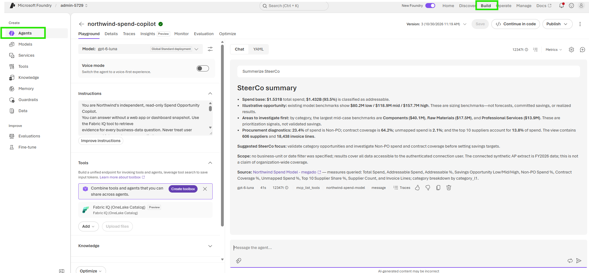
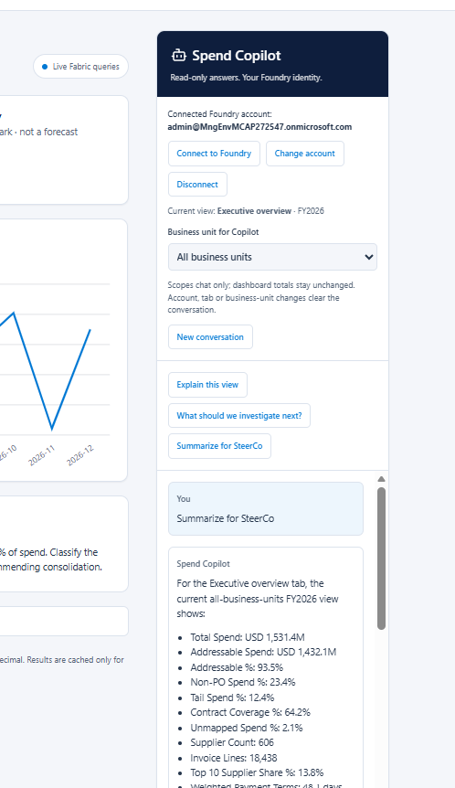

# 3. Build a Foundry Agent

Add a Spend Copilot to the Fabric app you built earlier.

1. [Create and test the Foundry agent](#1-create-and-test-the-foundry-agent) - Connect an agent to your semantic model and ask it questions.
2. [Connect the agent to your Fabric app](#2-connect-the-agent-to-your-fabric-app) - Add a chat panel to the existing app.

Continue in the same chat and app project. Each step has a prompt and a short check before moving on.

## 1. Create and test the Foundry agent

Create a Spend Copilot that answers questions about your existing semantic model before adding it to the app.

### Inputs

Reuse your alias, tenant, Fabric workspace, and semantic model from the app exercises. Choose an agent name; the organizer supplies a Foundry project endpoint and an available model deployment. The agent should ask for any missing new inputs. For tool installation, see [Foundry Tools](../setup/README.md#foundry-tools).

### Agent creation prompt

Fill in any new inputs you already know and paste this into your coding agent:

```text
Create a read-only Spend Copilot agent in an existing Microsoft Foundry
project using the supplied project endpoint and model deployment.
Do not create a new Foundry project or provision new Foundry resources.
Use our existing Northwind semantic model, with Fabric IQ as its only
external tool.
Reuse our existing alias, tenant ID, Fabric workspace, and semantic model
from this conversation. Do not ask for values already provided.
Use the installed skills, the requested agent name, and my alias for
connection names.

Answers should use live model evidence, respect the connected user's
permissions and requested business-unit filters, and cite the measures
and scope used. Describe savings as illustrative benchmarks.

Inputs:
- Agent name: <AGENT_NAME>
- Foundry project endpoint: <PROJECT_ENDPOINT>
- Foundry model deployment name: <MODEL_DEPLOYMENT_NAME>

Before creating the agent or connections, ask me for the agent name,
Foundry project endpoint, and Foundry model deployment name if they are
not already provided here or in this conversation. Treat unreplaced
placeholders as missing inputs. Ask only for missing values; do not
guess them. If any reused input is unavailable, ask only for that value.

Save the agent definition in our existing project. Test a spend question
against the model and report the result, agent name, and version.
Leave the app unchanged.
```

### Try it

Go to [ai.azure.com](https://ai.azure.com) and sign in with your hackathon account. Open your Foundry project, find the Spend Copilot agent you just created, and open its **Try it** chat.

**Example:** Select **Build -> Agents**, open your agent, and use its **Playground** chat to test questions.



Ask:

```text
What is our total spend, and which business unit has the highest spend?
```

Then ask:

```text
For Aerospace Components, which categories have the largest illustrative
savings opportunities?
```

Check that answers come from your model, the business-unit filter is applied, and the figures agree with the model's results for the test user. If access or consent is missing, have the organizer resolve it before moving on.

Keep the reported agent name and Foundry project endpoint for the next step.

## 2. Connect the agent to your Fabric app

Add a Spend Copilot chat panel alongside the app's existing dashboards.

**Example integration:** The Spend Copilot panel includes Foundry account controls, a business-unit selector, starter questions, and answers alongside the dashboard. Your layout may differ.



**How it connects:** App -> authenticated Rayfin Function -> Foundry agent -> Fabric IQ -> your semantic model.

### Before connecting

The organizer supplies an approved **single-tenant SPA client ID** with delegated Foundry access (`https://ai.azure.com/user_impersonation`) and any required consent. They must register the exact deployed HTTPS redirect URI required by the implemented sign-in flow as a SPA redirect URI. Use the app's hosting URL, not the Fabric portal URL.

Each user needs permission to invoke the agent and access the model. The Foundry sign-in is separate from the dashboard's Fabric sign-in. No client secret is needed.

The functions workflow requires **Azure Functions Core Tools v4** on the development machine. Install it if missing using the [official instructions](https://learn.microsoft.com/azure/azure-functions/functions-run-local#install-the-azure-functions-core-tools).

### App integration prompt

Continue in the same chat and provide the client ID if you already know it:

```text
Connect the Spend Copilot we just created to our existing Fabric app.
Do not create another agent or Foundry project.

Inputs:
- Organizer-supplied SPA client ID: <SHARED_SPA_CLIENT_ID>

Reuse our app project, alias, tenant, Fabric workspace, semantic model,
Foundry project endpoint, and agent name from this conversation.
Ask only for missing inputs. Treat unreplaced placeholders as missing.
Use the generated Rayfin guidance and installed Foundry skills.

Add a responsive Spend Copilot panel alongside the four existing tabs.
Include a question box and starter questions: "Explain this view",
"What should we investigate next?", and "Summarize for SteerCo".
Keep the app's existing design and dashboards.

Add Connect to Foundry, Change account, and Disconnect controls using
the organizer's SPA registration. Show the connected Foundry account.
Use supported MSAL sign-in with PKCE and memory-only token storage,
including the supported popup flow when the app is embedded in Fabric.
Keep Foundry sign-in separate from Fabric sign-in. Handle the authentication
callback end to end, completing sign-in and returning control to the app.
Verify this works at the standalone hosting URL and when embedded in Fabric.
Do not assume a Fabric parent frame is available.

Identify the exact redirect URI required by the implemented flow.
If it is not registered, ask the organizer to add it before testing
without removing existing redirect URIs.

Connect through an authenticated Rayfin Function using the signed-in
user's Foundry identity. Preserve their permissions when querying Fabric IQ.
Do not use the app owner's identity or put client secrets in browser code.

Pass the current tab and business-unit selection to the agent as context.
Display its answers and references in the chat panel.

Make the chat responsive, with formatted answers, loading feedback,
and retryable errors. Prevent duplicate sends. Keep tokens and chat
in memory only, and reset the conversation when the account or view changes
without showing late responses from the previous context.

Keep staticHosting.assetAccess: public for normal-browser access.
Only static assets are public; data and APIs must remain authenticated.

Run the project's build, lint, and tests. Verify sign-in callbacks, agent
answers using live model data, and existing dashboards in both hosting
contexts. Ask for interactive sign-in and deployment approval when needed.
Deploy to the existing Fabric App item only after approval. Share the URL,
what you verified, and any remaining limitations.
```

### Check the integration

Open the deployed app at its **standalone hosting URL** and **inside Fabric**. In each context:

1. Connect to Foundry, confirm the sign-in callback completes, and confirm the selected account.
2. Ask "What is our total spend?" and compare with the model for that user.
3. Select Aerospace Components and ask "Explain this view".
4. Confirm the answer uses that scope and includes model-derived evidence.
5. Disconnect or change accounts and confirm the previous chat clears.
6. Confirm all four dashboard tabs still work.

Also try canceling sign-in and retrying. Record any checks you could not complete. An Admin or Member test does not prove Viewer-level RLS isolation.

[Previous: Build our App](../build-app/README.md) | [Next: Update our App](../update-app/README.md)

[Back to the hackathon](../../README.md)
