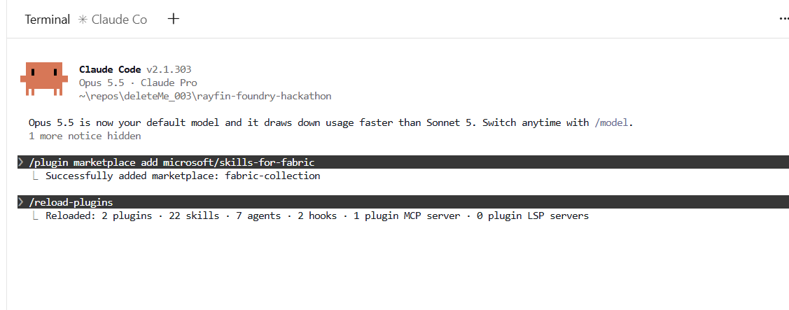
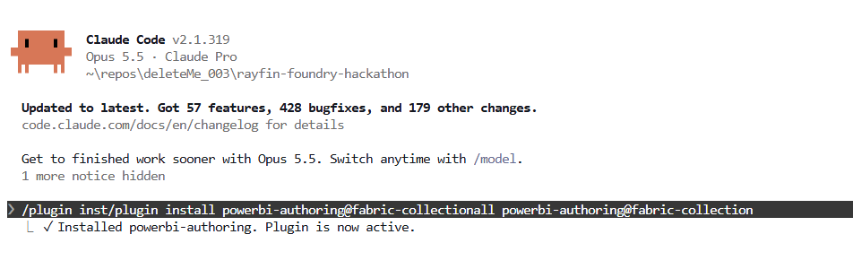

# Claude Code - Windows

Use the **terminal in Claude Desktop's Code tab** for these installation steps, not ordinary Claude Desktop chat or its Settings > Customize > Plugins screen.

## Before you start

Open Claude Desktop and sign in. Switch to the **Code** tab and open its **Terminal** pane. Clone the hackathon repository there, then start Claude Code from the repository root and keep that folder as your workspace for installation and verification.

## 1. Open Claude Code

Install [Claude Code](https://code.claude.com/docs/en/setup) if needed, following your organization's approved process. The hackathon's [local prerequisites](../setup/README.md#local-tools), including Git and Node.js/npm, are separate requirements.

In the Code tab's terminal, use PowerShell and navigate to the parent folder where you keep your repositories. If you have not cloned this repository yet, run:

```powershell
git clone https://github.com/memasanz/rayfin-foundry-hackathon.git
Set-Location .\rayfin-foundry-hackathon
```

If you already cloned it, navigate to that existing repository's root instead. From the repository root, start Claude Code:

```powershell
claude
```

Complete sign-in and review any workspace trust prompt. Wait until Claude's interactive chat opens.

**Run the `/plugin` commands below inside Claude's chat, not at the `PS C:\...>` PowerShell prompt.** If PowerShell reports that `/plugin` is not recognized, start `claude` first. If `claude` itself is not recognized, finish its installation and reopen your terminal.

## 2. Add the Fabric marketplace

At the **Claude Code chat prompt**, enter:

```text
/plugin marketplace add microsoft/skills-for-fabric
```

Wait for **Successfully added marketplace: fabric-collection**.



The screenshot shows marketplace confirmation and a plugin reload. Adding a marketplace does not install its plugins; continue with the next step.

## 3. Install the plugins

Enter each command in Claude Code and wait for it to finish:

```text
/plugin install fabric-skills@fabric-collection
/plugin install powerbi-authoring@fabric-collection
/plugin install azure@claude-plugins-official
```

Wait for confirmation that each plugin is installed and active, as shown for `powerbi-authoring` below. Use the commands above; the screenshot's input line contains duplicated text.



| Plugin | Purpose |
|---|---|
| `fabric-skills` | Fabric workflows, including lakehouses, Spark, SQL, and OneLake |
| `powerbi-authoring` | `semantic-model-authoring` and `powerbi-report-cli` |
| `azure` | Azure and Foundry tools and skills, including `microsoft-foundry` |

Review installation and trust prompts before accepting them. If marketplace access is blocked by organization policy, contact the organizer or IT rather than bypassing it.

## 4. Verify skill availability

Start a **new Claude Code session** in the hackathon folder after installation. Where supported, `/reload-plugins` refreshes plugins in the current session, as shown in the screenshot.

Paste:

```text
Check whether these skills or plugins are available in this session:
- semantic-model-authoring
- powerbi-authoring
- microsoft-foundry

Use your available skill and plugin lists and report each as available, missing,
or unable to verify. Do not assume availability from general knowledge.
Do not install or update anything, invoke skill workflows, or change settings.
```

Installation does not sign you into Azure, grant Fabric or Foundry permissions, or prove live connectivity. For the Foundry exercises, also follow [Foundry Dev Pack - Windows](foundry-devpack-windows.md).

References: [Claude Code skills](https://code.claude.com/docs/en/skills), [Microsoft Fabric skills](https://github.com/microsoft/skills-for-fabric), and [Azure plugin for Claude Code](https://github.com/microsoft/azure-skills#claude-code).

[Back to the hackathon](../../README.md)
