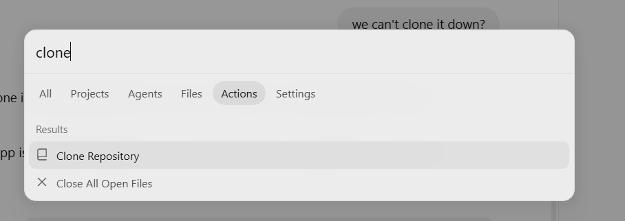
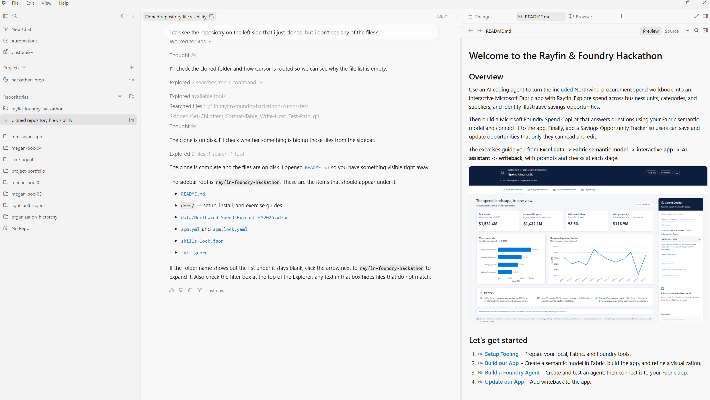

# Cursor IDE - macOS

Choose **one complete installation option** below. Each includes Fabric skills, **`semantic-model-authoring`**, **`powerbi-report-cli`**, and **`microsoft-foundry`**.

## 1. Install Cursor

1. Download and install [Cursor for macOS](https://cursor.com/downloads).
2. Open Cursor and sign in.
3. Open your local hackathon folder. If you have not cloned it yet, follow [First run in Cursor](#first-run-in-cursor) below.

For Node.js, Git, and other prerequisites, see [Setup Tooling](../setup/README.md#local-tools).

## 2. Install the hackathon skills

Run the commands for your chosen option from the hackathon project folder. Keep the installation project-local so Cursor can use it for this workshop.

### Option 1: Clone both repositories

Clone the full repositories under `.agents/skills`:

```bash
mkdir -p .agents/skills
git clone https://github.com/microsoft/skills-for-fabric.git .agents/skills/skills-for-fabric
git clone https://github.com/microsoft/azure-skills.git .agents/skills/azure-skills
```

Cursor supports nested skill folders under `.agents/skills`. Keeping each repository intact preserves its references and supporting files. The Fabric repository includes `semantic-model-authoring` and `powerbi-report-cli`; the Azure repository includes `microsoft-foundry` and additional Azure skills.

In Cursor's Skills view, look for **`powerbi-report-cli`** for report authoring. **`powerbi-authoring`** is a marketplace plugin name, not an individual skill.

### Option 2: APM backup

Install **APM (Agent Package Manager)** if it is missing:

```bash
curl -sSL https://aka.ms/apm-unix | sh
```

Restart your terminal and Cursor after installation. If `apm` is not found, open a new Terminal window so it picks up the updated PATH.

From the hackathon folder, run both commands:

```bash
apm install microsoft/skills-for-fabric --target cursor --only apm
apm install microsoft/azure-skills --skill microsoft-foundry --target cursor --only apm
```

APM installs the Fabric/Power BI collection and the Foundry skill, preserving and rewriting shared references. Keep `apm_modules` in the project: installed skills use it. `--only apm` skips MCP server registration.

After your chosen installation, restart Cursor and reopen the hackathon folder. These options install skill files, not local development tools, authentication, or permissions. Continue with [Foundry Tools](../setup/README.md#foundry-tools) for the separate Foundry tooling setup.

## First run in Cursor

### Clone and open the hackathon repository

This clones the **hackathon repository**, not the skill repositories in option 1 above. Do this before running the skill installation commands if you do not already have the hackathon on your computer. The screenshots below are Windows examples; use the macOS shortcut here.

1. Press **Command+Shift+P** and search for **Git: Clone** or **Clone Repository**.
2. Paste the hackathon repository URL provided by the organizer and choose a local directory.
3. Open the cloned folder in Cursor and select that repository when starting a conversation.



If the repository appears in the sidebar but you do not see a file tree, ask your agent to open `README.md`. The agent can work with the files in the selected repository even when the sidebar is showing conversations rather than Explorer.



### Run your first local-tools check

Open [Setup Tooling's local-tools prompt](../setup/README.md#check-your-local-tools-with-your-coding-agent), copy it, and paste it into a chat for the cloned hackathon repository. Allow the version and package-access checks when Cursor asks.

The agent should report which tools are installed, missing, or incompatible, with next actions. The prompt does not install anything or change settings. Complete any missing local-tool setup before running the skill installation commands above; this check is separate from Fabric and Foundry access.

### If npm access is blocked

Use your organization's approved npm registry. **For Microsoft-managed devices only**, if your IT documentation directs you to the Microsoft package proxy, open Cursor's terminal and run:

```bash
npm config set registry https://packagefeedproxy.microsoft.io/npm/ --location=user
npm view @microsoft/create-rayfin version
```

This changes your user-level npm registry across projects. Other participants should use their own approved registry, not assume access to Microsoft's proxy. A package lookup is more useful here than `npm ping`, which can return 404 on this proxy. Rerun the local-tools prompt after resolving the registry issue.

References: [Cursor skill directories](https://cursor.com/docs/skills#skill-directories), [Microsoft Fabric skills](https://github.com/microsoft/skills-for-fabric), and [Microsoft Azure skills](https://github.com/microsoft/azure-skills).

[Back to installation guides](README.md) | [Back to Setup Tooling](../setup/README.md)

[Back to the hackathon](../../README.md)
