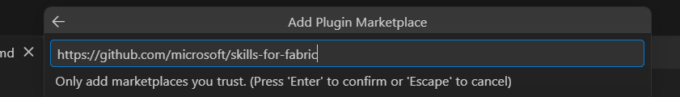
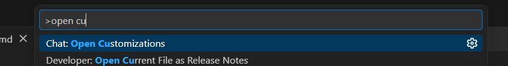
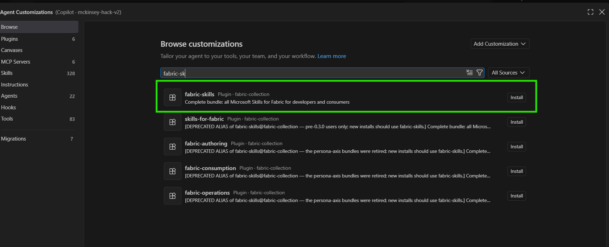
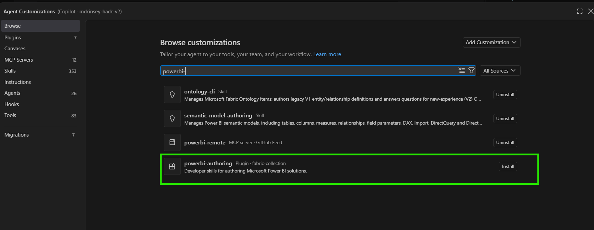
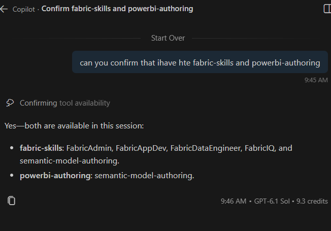
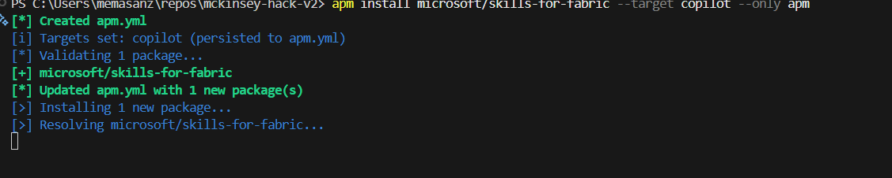

# GitHub Copilot in VS Code - macOS

## Before you start

Open the hackathon folder in VS Code and sign in to GitHub Copilot. Use the **Copilot** harness in Chat for installation and verification.

Choose **one of four options** to install the skills:

1. **[Marketplace through the VS Code UI](#1-add-the-fabric-marketplace)**: browse and install the plugins in VS Code.
2. **[Marketplace through Copilot CLI](#alternative-install-through-copilot-cli)**: install the plugins with terminal commands.
3. **[Clone the repositories](#alternative-clone-the-repositories)**: keep the complete repositories and configure skill discovery.
4. **[Direct installation with APM](#if-marketplace-access-is-blocked)**: bypass the Marketplace and install the skills directly from GitHub, where your organization's policy permits.

## 1. Add the Fabric marketplace

1. Press **Command+Shift+P**, run **Chat: Open Customizations**, and select **Browse**.
2. Open the source menu and select **Configure Marketplaces**.
3. Select **Add Marketplace** and enter:

   ```text
   https://github.com/microsoft/skills-for-fabric
   ```

4. Press **Enter** to add the marketplace. Review the source and confirm any trust prompt only if your organization's policy permits it.
5. Return to **Browse** and select the added **fabric-collection** marketplace.



## 2. Install both plugins

1. Press **Command+Shift+P** to open the Command Palette.
2. Type **Chat: Open Customizations**, select the command, and press **Enter**.



3. Select **Browse** and search for **fabric-skills**. If needed, choose **fabric-collection** from the **All Sources** menu.
4. Review **fabric-skills** from **fabric-collection** and select its **Install** button. Choose the highlighted entry below, not an entry marked **DEPRECATED ALIAS**.



5. Clear the search and search for **powerbi-authoring**. Review the **powerbi-authoring** plugin from **fabric-collection** and select its **Install** button. Choose the highlighted plugin, not an individual skill or MCP server.



| Plugin | Purpose |
|---|---|
| `fabric-skills` | Fabric workflows, including lakehouses, Spark, SQL, and OneLake. |
| `powerbi-authoring` | Plugin containing the `semantic-model-authoring` and `powerbi-report-cli` skills for semantic models, reports, and PBIP authoring. |

These are agent plugins, not extensions in the Visual Studio Marketplace. Plugins may include MCP servers as well as skills; installation alone does not configure authentication or grant Fabric access.

## 3. Verify the skills

1. After installing both plugins, open the Copilot Chat panel and select **New Chat**. Keep the hackathon workspace open; you do not need to restart VS Code.
2. Ask your agent:

```text
Can you confirm that the fabric-skills and powerbi-authoring plugins
are available in this session, including the semantic-model-authoring
and powerbi-report-cli skills?
```

The agent should check its available tools and skills and report capabilities from **both plugins**, as shown below. A general description of Fabric or Power BI is not enough to confirm availability.



If either plugin is missing or cannot be confirmed, return to **Install both plugins**, check its installation, and repeat the check in a new chat. This checks session availability, not Fabric authentication or connectivity.

Open a **new Copilot chat** with the hackathon folder open and paste this prompt to check all three hackathon skills, whether installed earlier or just now. This also works with the clone and APM installation options below:

```text
Check whether these skills are available in this session:
- semantic-model-authoring
- powerbi-report-cli
- microsoft-foundry

Use your available skill list and report each as available, missing,
or unable to verify. Do not assume availability from general knowledge.
Do not install or update anything, invoke skill workflows, or change settings.
```

## Alternative: install through Copilot CLI

Use this **instead of** the UI installation steps if you prefer the terminal. It still uses the Fabric marketplace; if marketplace access is blocked, use a direct installation option below, where permitted.

1. In VS Code, select **Terminal > New Terminal** and make sure you are in the hackathon workspace folder. Check that Copilot CLI is installed:

   ```bash
   copilot --version
   ```

   If the command is not found, follow the [official Copilot CLI installation instructions](https://docs.github.com/en/copilot/how-tos/copilot-cli/install-copilot-cli).

2. Start Copilot CLI and complete sign-in if prompted:

   ```bash
   copilot
   ```

3. At the **Copilot CLI prompt**, add the marketplace and wait for confirmation:

   ```text
   /plugin marketplace add microsoft/skills-for-fabric
   ```

4. Install the Fabric plugin and wait for installation to finish:

   ```text
   /plugin install fabric-skills@fabric-collection
   ```

5. Install the Power BI plugin and wait for installation to finish:

   ```text
   /plugin install powerbi-authoring@fabric-collection
   ```

6. Exit the CLI session:

   ```text
   /exit
   ```

   `/exit` closes the CLI session and returns you to your terminal shell.

VS Code can discover plugins installed by Copilot CLI. Start a **new VS Code Copilot chat** and follow [Verify the skills](#3-verify-the-skills) above. To use the skills in the CLI instead, start `copilot` again and run `/skills`.

## Alternative: clone the repositories

Use this **instead of** the marketplace steps if you want the complete supporting files. With **Git** installed, run these commands in a terminal in the **hackathon workspace folder**:

```bash
mkdir -p .skill-sources
git clone https://github.com/microsoft/skills-for-fabric.git .skill-sources/skills-for-fabric
git clone https://github.com/microsoft/azure-skills.git .skill-sources/azure-skills
```

In VS Code, run **Preferences: Open Workspace Settings (JSON)** from the Command Palette and merge these entries into your existing settings:

```json
{
  "chat.agentSkillsLocations": {
    ".skill-sources/skills-for-fabric/skills": true,
    ".skill-sources/azure-skills/skills": true
  }
}
```

VS Code forwards these configured skill locations to the selected harness. This setting remains supported for compatibility, though it is deprecated in favor of native skill locations. Here it lets the skills stay in their original repository layout, preserving shared references.

For **standalone Copilot CLI**, also register the directories in its own settings:

```bash
copilot skill add .skill-sources/skills-for-fabric/skills
copilot skill add .skill-sources/azure-skills/skills
```

This includes **Fabric skills, `semantic-model-authoring`, `powerbi-report-cli`, and `microsoft-foundry`**, plus the Azure repository's other skills. Keep both clones in place and start a **new Copilot chat**. Cloning alone does not configure MCP connections, tooling, authentication, or permissions.

Paste the [installed-skills verification prompt](../setup/README.md#confirm-your-installed-skills) in that new chat to check skill availability.

## If marketplace access is blocked

If your organization permits direct GitHub downloads, use **Agent Package Manager (APM)** instead of the marketplace. This does not bypass organization policy; if these downloads are also blocked, contact the hackathon organizer.

### 1. Install APM if needed

If APM is already installed, skip to step 2. Otherwise, in VS Code, select **Terminal > New Terminal** and run the official Microsoft APM installer if permitted by your organization:

```bash
curl -sSL https://aka.ms/apm-unix | sh
```

After installation, **save your work and fully quit VS Code with Command+Q**, then reopen it so it picks up PATH changes. Open the hackathon folder and select **Terminal > New Terminal**. If installation is blocked, contact the organizer rather than changing managed settings.

### 2. Install the Fabric and Power BI skills

Make sure your terminal is in the **hackathon workspace folder**. APM requires Git; check with `git --version`. If Git is missing, use your organization's approved installation method or the [Git for macOS instructions](https://git-scm.com/install/mac).

Run:

```bash
apm install microsoft/skills-for-fabric --target copilot --only apm
```

APM uses GitHub as the default host for `owner/repository` references, so `microsoft/skills-for-fabric` resolves to `https://github.com/microsoft/skills-for-fabric`. No full URL is needed.

**Semantic model and report skills only:** for a fresh setup that needs only `semantic-model-authoring` and `powerbi-report-cli` (the skills in the `powerbi-authoring` plugin), use this command **instead of** the full-bundle command above:

```bash
apm install microsoft/skills-for-fabric --skill semantic-model-authoring --skill powerbi-report-cli --target copilot --only apm
```

`powerbi-authoring` is the Marketplace plugin name; APM selects its underlying skills by name. This command saves the skill selection in `apm.yml`. It does not configure the plugin's MCP server. If the full bundle is already installed, this command does not remove its other skills.

The Windows example below shows the same APM command resolving the package:



Wait for installation to finish successfully. If `apm` is not found, **save your work and fully quit VS Code with Command+Q**, then reopen it and retry in a new terminal. Closing a window alone does not necessarily quit VS Code. If it is still not found, follow any PATH instructions printed by the installer or contact the organizer rather than changing managed settings.

This installs the repository's Fabric and Power BI skills, plus its bundled agent definitions, directly into the project. It does **not** register the marketplace or install the two named plugin entries. `--only apm` skips MCP server registration; authentication and live Fabric connectivity remain separate.

Keep the generated `apm_modules` folder: the installed skills use its shared references.

Start a **new Copilot chat** in the same workspace and ask:

```text
Can you confirm that the APM-installed semantic-model-authoring
and powerbi-report-cli skills are available in this session?
Check the installed skill files and report anything you cannot verify.
```

After completing [Foundry Tools](../setup/README.md#foundry-tools), repeat the check with the [installed-skills verification prompt](../setup/README.md#confirm-your-installed-skills) to include `microsoft-foundry`.

References: [VS Code agent plugins](https://code.visualstudio.com/docs/agent-customization/agent-plugins), [VS Code agent skills](https://code.visualstudio.com/docs/agent-customization/agent-skills), [Copilot CLI skills](https://docs.github.com/en/copilot/how-tos/copilot-cli/customize-copilot/add-skills), [Microsoft Fabric skills](https://github.com/microsoft/skills-for-fabric), and [APM installation](https://microsoft.github.io/apm/getting-started/installation/).

[Back to the hackathon](../../README.md)
