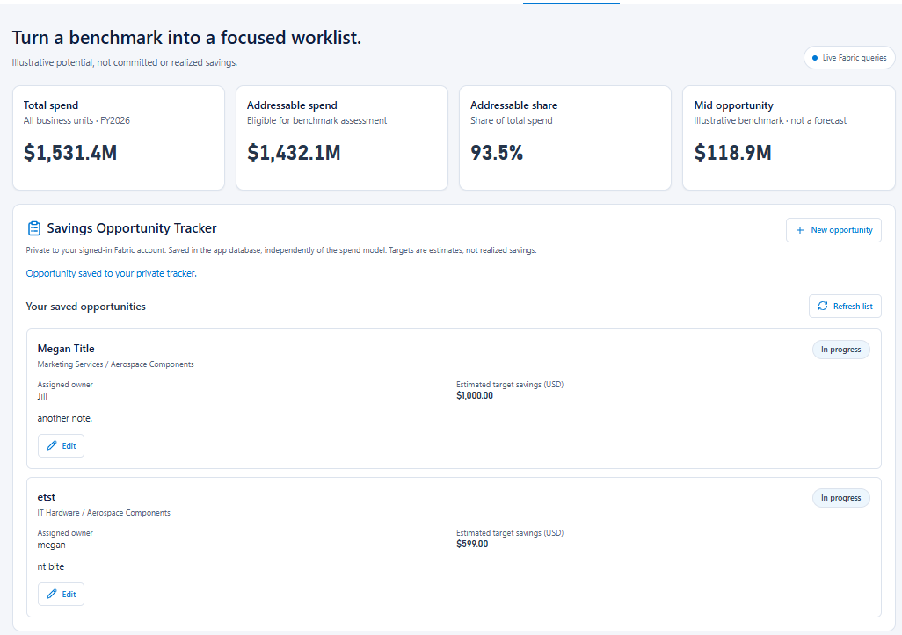

# 4. Update our App with Writeback

Continue with the app after [connecting your Foundry agent](../foundry-agent/README.md#2-connect-the-agent-to-your-fabric-app).

Turn the Opportunity tab into a **Savings Opportunity Tracker**: move from finding potential savings to recording and tracking actions.

For example, select a category with fragmented supplier spend, record a consolidation opportunity, assign an owner, and track its progress.

**Example writeback:** The Savings Opportunity Tracker shows saved opportunities with status, assigned owner, estimated target savings, and edit controls. Your layout may differ.



## What you will add

A saved opportunity has a category, business unit, title, owner, status, target savings amount, and notes. Users can read and edit only opportunities they created. The creator is recorded from their signed-in identity and cannot be changed; the editable owner field does not grant access.

These are new operational records saved in the app's Rayfin-managed database, not changes to the Excel workbook or historical spend model. Target savings are user-entered estimates, separate from the model's illustrative benchmarks. Saving an opportunity does not automatically add it to the semantic model or the agent's Fabric IQ results.

## Prompt

Continue in the same chat with your existing app:

```text
Add a Savings Opportunity Tracker to the Opportunity tab in our existing app.

Let me select a category and business unit, then create an opportunity
with a title, owner, status, target savings in USD, and notes.
Use statuses New, In progress, and Completed.
Show only opportunities I created and let me edit only those opportunities.
Record the creator from the signed-in identity, not a user-entered field.
Enforce this on backend reads and updates, not just by filtering the UI.
The creator cannot be changed, and assigning an owner does not grant access.

Persist these records in the app's Rayfin-managed database so they survive
a refresh. Use the generated Rayfin guidance for data modeling, permissions,
and write operations. Keep the existing sign-in and require authorized access.
Leave the source workbook and spend semantic model unchanged.

Preserve the existing dashboards and Spend Copilot panel.
Match the existing design. Validate required fields and non-negative target
savings, show save progress and errors, and label target savings as estimates.
Test create, read, and update behavior with two different users to verify
they cannot read or edit each other's records, then deploy the updated app.
```

## Check the result

1. Create a test opportunity for a category shown in the app.
2. Save it, refresh the page, and confirm the record is still there.
3. Change its status and notes, save, and refresh again.
4. Confirm invalid entries are rejected and failed saves do not appear successful.
5. Sign in as a second user. Confirm they cannot list, directly retrieve, or update the first user's opportunity, even with its record ID.
6. Create an opportunity as the second user and confirm the first user cannot read or edit it. Changing the owner field must not transfer access.
7. Confirm the original dashboard totals are unchanged.
8. Confirm the Spend Copilot still answers questions about the spend model.

You have demonstrated **writeback** when a user-entered change is saved to the backend and can be read back after a refresh, not just displayed temporarily in the browser.

## Note: Making the agent aware of opportunities

The opportunities are stored in the app's database, not the semantic model. The Foundry agent queries the model through Fabric IQ, so it cannot see these records automatically.

As a possible next step **outside the scope of this hackathon**, give the agent a tool that reads the signed-in user's opportunities, or bring the opportunity data into the semantic model. Either approach must preserve the same creator-only access controls so users cannot retrieve someone else's opportunities through the agent.

[Previous: Connect the agent to your Fabric app](../foundry-agent/README.md#2-connect-the-agent-to-your-fabric-app)

[Back to the hackathon](../../README.md)
